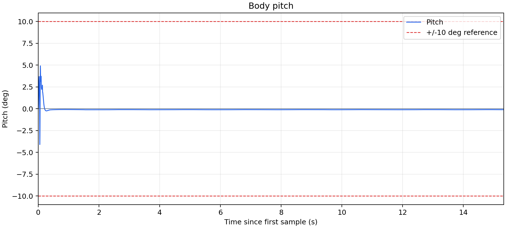

# 控制结构
## 控制逻辑
控制器的目的是接收仿真器从imu和joint两个topic传来的状态参数并计算对应目标速度下的电机力矩然后通过actutor发布。
观察仿真器的控制结构，其发布顺序为先发布imu消息再发布joint消息，并且两个消息的stmap是完全相同的，因此，处理数据时可以直接按照这个顺序，当两种消息都接收到了并且其stamp相同时就可以计算力矩并发布

## 计算逻辑/参数来源
控制器初始化时定义自身对象，订阅的topic的callback函数被调用时，利用自身对象接住传来的消息。因为仿真器中joint消息后传来，所以只需要在joint话题对应的callback函数中调用判断是否计算并发布的函数即可，这样可以实现等到所有消息都接收到了再计算并发布。     
imu消息的处理搬运了蓝本中的robot_info_update.py的算法，其余参数大体为直接接收再参与轮腿控制函数的运算，轮腿控制函数也是直接搬运的。


这里复用了大量的原代码，包括所有计算逻辑。难点在于梳理原代码的变量之间代表了什么量，往哪里传了，各个控制器对象的功能是什么需要什么参数，谁从哪里算出来的又要作为谁的参数。由于代码能力有限，这里基本所有的参数都定义成了self的对象并初始化为0或者None，方便在不同函数中任意赋值或者调用。   
这里也剥离了键盘控制逻辑。     
同时，原代码有似乎一些冗余的变量并没有参与运算，这里也保留了。

另，实际注意到蓝本的离地检测一旦开启，便会在第一个坎摔跤。  
正常情况下，速度似乎只能控制在0.6m/s，其他速度均会摔跤。    
这里没有使用离地检测，但是保留了其原有控制逻辑。

# 测试结果
```
#启动仿真器
ros2 run wheel_leg_sim wheel_leg_sim
#启动控制器
ros2 run wheel_leg_controller wheel_leg_controller
#外部传入目标速度
ros2 topic pub -r 10 /cmd_vel geometry_msgs/msg/Twist \
  "{linear: {x: 0.6}, angular: {}}"

```
能通过全部坎    
不从外部传入目标速度时保持原地站立


## 保存 pitch CSV 与画图

控制器在 `_process_imu()` 算出 pitch 后直接追加一行到启动目录的 `pitch.csv`。
每次启动控制器会重新写这个文件。每行写完就关闭文件，Ctrl+C 后可以直接画图。

三列分别是：

- `stamp_s`：消息原始时间戳，单位秒。
- `pitch_deg`：当前 pitch，单位度。
- `sim_time_s`：原始时间戳减去首条时间戳，作为从 0 开始的横轴。

仿真器默认使用现实时间戳，所以当前 CSV 横轴表示现实经过的秒数；列名 `sim_time_s` 不会自动把它转换为仿真时间。

```bash
# 终端 A
ros2 run wheel_leg_sim wheel_leg_sim

# 终端 B
ros2 run wheel_leg_controller wheel_leg_controller
```

运行一段时间后 Ctrl+C 停止控制器，再运行本包的 [plot_pitch.py](wheel_leg_controller/plot_pitch.py)。它与控制器放在同一个代码目录，读取 CSV 并直接生成 PNG。

以下命令在 `ros2_ws` 目录执行。本机系统 Python 已安装 Matplotlib，使用 `/usr/bin/python3`：

```bash
/usr/bin/python3 src/wheel_leg_controller/wheel_leg_controller/plot_pitch.py pitch.csv \
  -o src/wheel_leg_controller/pitch.png
```

图片保存在本包目录的 `pitch.png`，红色虚线表示 ±10° 参考线。省略 `-o` 时，图片保存在 CSV 旁边，名称相同、后缀为 `.png`。重复绘图会覆盖同名图片。

绘图程序只依赖 Matplotlib，不需要启动 ROS 节点。若其他 Python 环境缺少该库，可用对应环境的 `python -m pip install matplotlib` 安装。

下面的图片由当前已有的 `pitch.csv` 生成：



## Bag 录制提交物

已录制当前控制器的原地零速度运行，bag 实际时长为 **17.867 秒**，满足 10–20 秒要求。仿真器使用默认模型、无界面模式和 1 倍实时速度；此次没有发送 `/cmd_vel`。

录制数据原样保存在 [balance_bag/](../../balance_bag/) 目录，其中包含 `metadata.yaml` 和 `balance_bag_0.db3`。

| 话题 | 消息数量 |
| --- | ---: |
| `/imu` | 8,935 |
| `/joint_states` | 8,935 |
| `/actuator_cmd` | 8,934 |

共 26,804 条消息，此次 bag 中记录的 pitch 最大绝对值为 4.917°。

